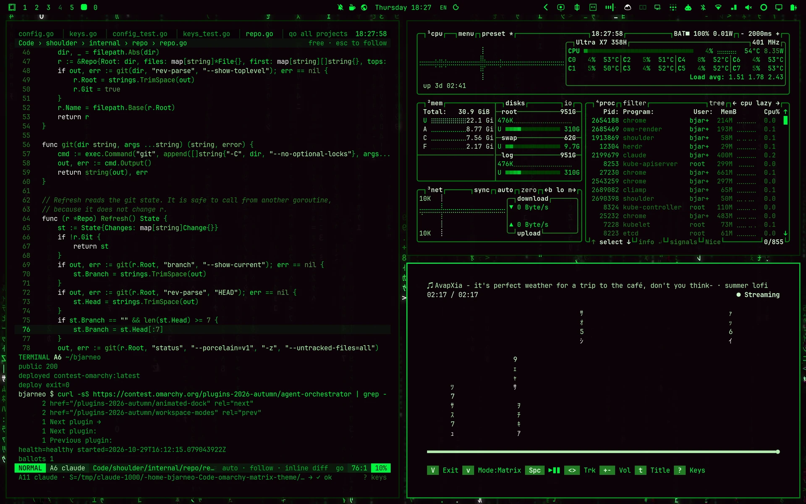
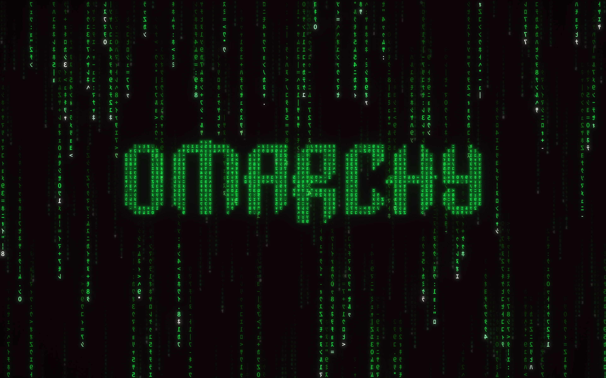
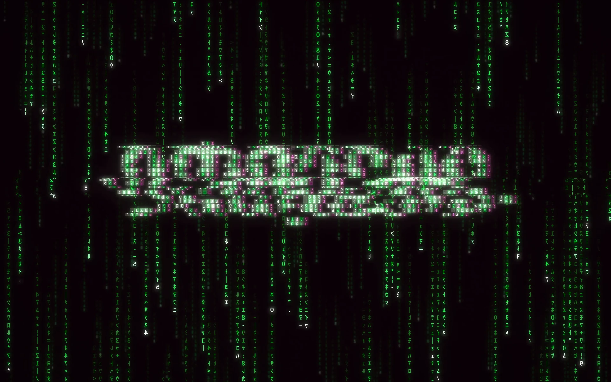
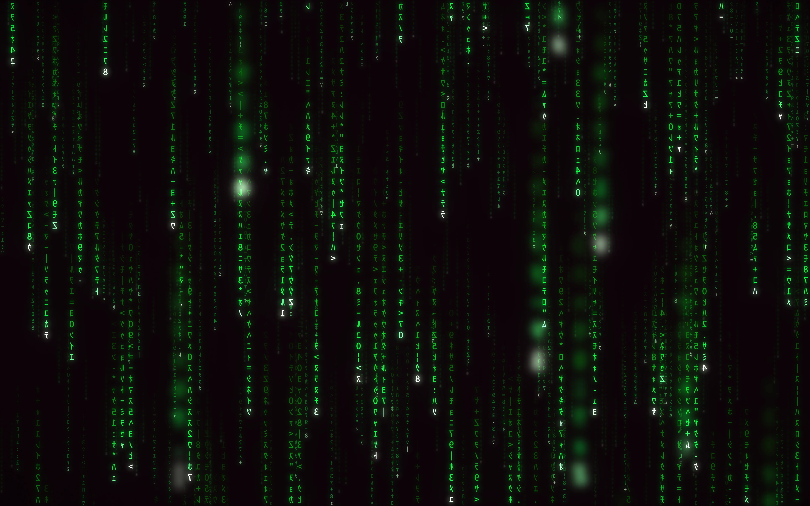
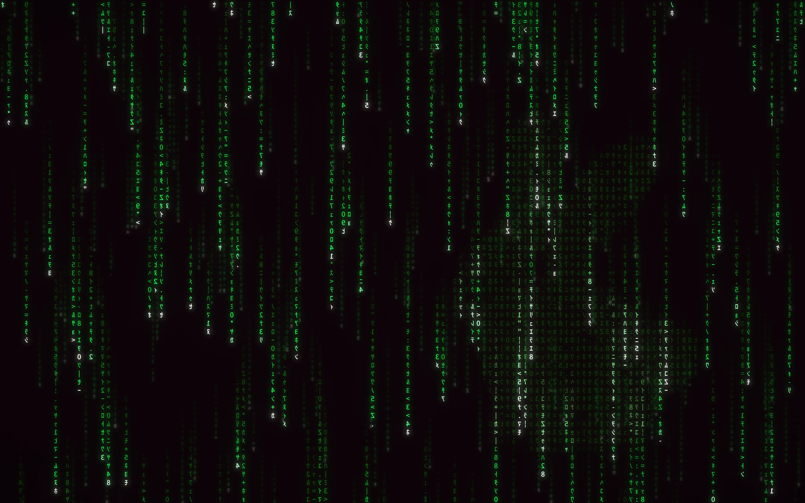
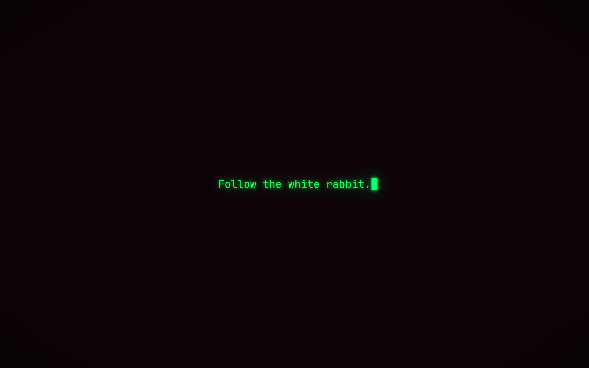

# Matrix

A theme for [Omarchy](https://omarchy.org) built from the digital rain. Your desktop wakes up with "Wake up, Neo...", the code pours in, and the Omarchy logo locks into place. The background keeps raining, and the logo glitches through the code now and then.



## Install

```bash
omarchy theme install https://github.com/bjarneo/omarchy-matrix-theme
```

Omarchy applies the theme and plays the first intro. To switch back, open the theme menu or run `omarchy theme set <name>`.

A theme installed from a remote cannot ship `hyprland.lua`. Omarchy then generates the window borders from `colors.toml`. To get the Malachite border gradient, link the repository into your themes instead:

```bash
git clone https://github.com/bjarneo/omarchy-matrix-theme ~/Code/omarchy-matrix-theme
ln -s ~/Code/omarchy-matrix-theme ~/.config/omarchy/themes/matrix
omarchy theme set matrix
```

## What you get

- 5 wallpapers and 2 endless video backgrounds, all rendered from one simulation of the digital rain.
- 3 animated intros. Each intro ends on the frame of its wallpaper, so the wallpaper takes over without a jump.
- A palette made only of the 4 Matrix colors and their variants, for terminals, Neovim, VS Code, btop, and the Omarchy shell.
- A Malachite border gradient on the active window, Yaru-olive icons, and a Malachite boot logo.

## Backgrounds

To pick a background, press `Super + Ctrl + Space`. To go to the next one, run `omarchy theme bg next`.

| | |
| --- | --- |
|  |  |
| `1-wake-up.webp` and `2-hello.webp`: the Omarchy logo, formed out of the code. | `3-glitch.mp4`: a 24-second seamless loop. The logo glitches through the code 3 times in each loop. |
|  |  |
| `5-deep-code.webp`: four planes of code at different depths, with a shallow focus. | `6-white-rabbit.webp`: a white rabbit formed out of the code. Look for it. |
|  | |
| `7-follow-the-white-rabbit.webp`: the terminal line from the film on a black screen. | `4-digital-rain.mp4`: the same loop as `3-glitch.mp4`, without the logo. |

### Intros

An intro plays when you apply the theme and when you log in. Omarchy plays an intro only before a still background, so the two video backgrounds start without one.


| Background | Intro |
| --- | --- |
| `1-wake-up.webp` | Types "Wake up, Neo...", "The Matrix has you...", "Follow the white rabbit." and "Knock, knock, Neo.". Then the code pours in, erases the text, and locks into the logo. |
| `2-hello.webp` | Types "Hello, Neo...". The text glitches apart, the code pours in, and the logo glitches in and locks into place. |
| `5-deep-code.webp` | The four planes pour in from back to front. |


To turn the intros off, run:

```bash
omarchy theme bg intro disable
```

## Palette

Every color in `colors.toml` is one of 4 core colors or a variant of one. The core colors are the palette that fan sites give for the digital rain. They are not official values from the film.

| Core color | Color | Use |
| --- | --- | --- |
| Vampire Black | `#0D0208` | Background |
| Dark Green | `#003B00` | Selection |
| Islamic Green | `#008F11` | Dim text |
| Malachite | `#00FF41` | Text, accent |

A variant keeps the OKLCH hue of its core color and changes only the lightness and the chroma. The 3 greens share one hue, so the code roles differ by lightness, saturation, and weight:

| Code role | Color | Variant of | Look |
| --- | --- | --- | --- |
| Keywords | `#EDFEEC` | Malachite | Bold, white-hot like the leading glyph of a stream |
| Variables | `#00FF41` | Malachite | Malachite |
| Strings, added lines | `#B8FFB7` | Malachite | Pale green |
| Parameters | `#83FC88` | Malachite | Light green |
| Numbers | `#0DE13B` | Malachite | Deeper Malachite |
| Functions | `#29C22F` | Islamic Green | Bold, deep green |
| Types | `#86DD82` | Islamic Green | Bold sage |
| Properties | `#AFE1AA` | Dark Green | Light sage |
| Comments | `#247D25` | Islamic Green | Dim green |
| Errors, deleted lines | `#F6FFF6` | Malachite | White-hot |

Errors are the brightest color on the screen, so they stand out by lightness instead of by hue. Comments reach 3.9:1 contrast on the background. All other code colors reach 8.6:1 or more.

The backgrounds use the same colors. The only exception is the glitch. It splits into a white-hot ghost and a raspberry ghost, which is Vampire Black lifted until its crimson hue shows.

## Files

| File | What it does |
| --- | --- |
| `colors.toml` | The palette. Omarchy generates the terminal, Neovim, VS Code, and shell colors from it. |
| `hyprland.lua` | A Malachite to Islamic Green border gradient on the active window. |
| `btop.theme` | Graphs that fall from Dark Green to a white-hot Malachite. Heat burns white-hot. |
| `icons.theme` | The Yaru-olive icons. |
| `unlock.png` | The Omarchy logo in Malachite for the boot screen. |
| `backgrounds/` | The wallpapers, the video loops, and the intros. |

To use the theme for the boot screen, run this command. It asks for your password:

```bash
omarchy plymouth set by theme matrix
```

## Credits

- The glyphs are the mirrored half-width katakana of Noto Sans CJK JP, under the SIL Open Font License.
- The rabbit outline comes from Noto Color Emoji, under the SIL Open Font License.
- The logo comes from Omarchy.
